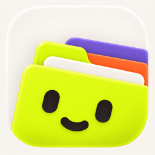
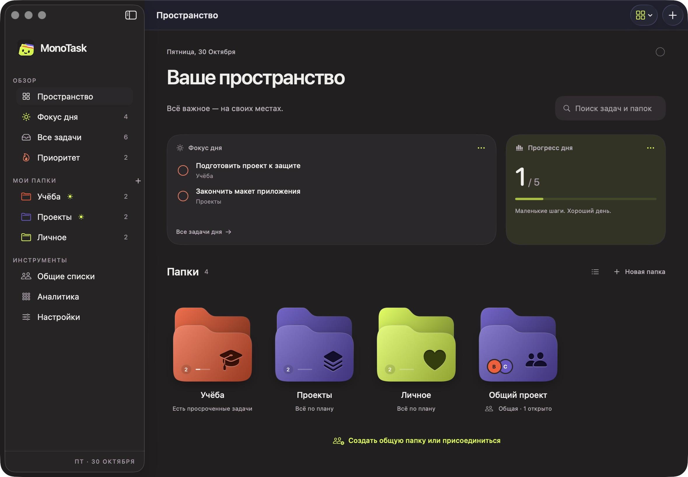
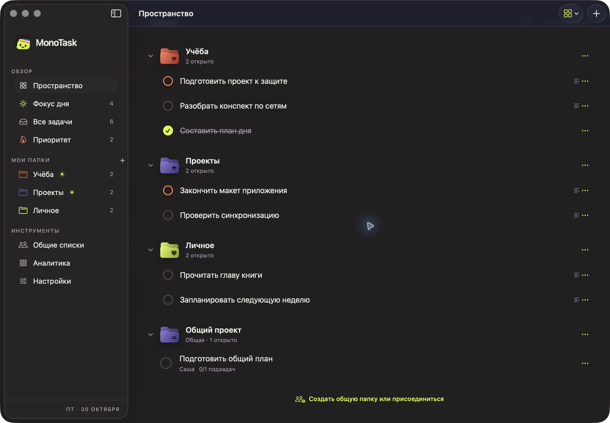
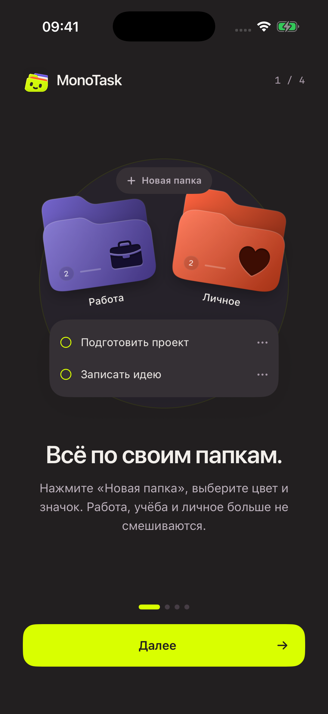
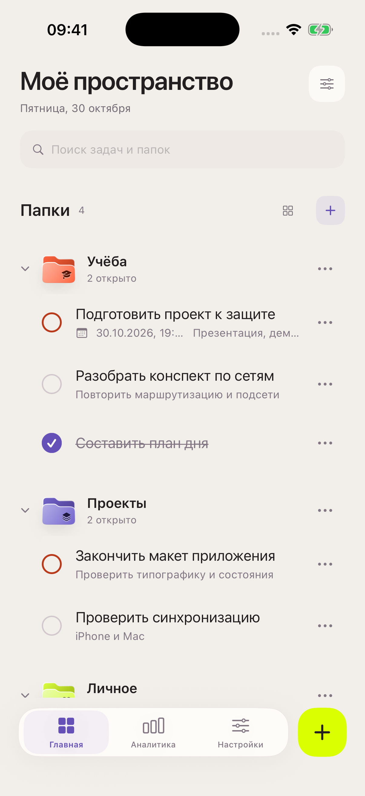

<div align="center">



# MonoTask

### Меньше шума. Больше сделанного.

Ваши задачи, папки и общие планы — в одном пространстве на iPhone и Mac.

**macOS 15+ · iOS 18+ · Swift 6 · SwiftUI**

[Скачать для Mac](https://github.com/tihshkel/Mono-Task/releases/latest) · [Что нового](CHANGELOG.md) · [Собрать самому](#сборка-из-исходников) · [Документация](#документация)



</div>

MonoTask помогает разложить дела по местам и спокойно двигаться дальше. Откройте папку, запишите мысль, отметьте выполненное. Для совместных планов пригласите друга — личные задачи при этом останутся личными.

Без браузерной оболочки: нативный интерфейс, горячие клавиши, локальные данные и синхронизация между устройствами.

## Новое в 2.2

### Папки, в которых сразу видны дела

Переключайтесь между объёмными папками и раскрывающимся списком без лишних рамок. В списке задачи доступны сразу: выполнить, изменить, удалить или вернуть в работу можно прямо в пространстве. Каждая папка сворачивается независимо, а поиск находит задачи и внутри общих папок.



### Цвет — не только название

**24 цвета и 48 значков** для работы, учёбы, личного и всего остального. Оттенок виден на всей папке: объём, мягкие блики и тиснение сохраняются и на светлом, и на тёмном фоне.

### Мысль не должна ждать

На Mac нажмите **⌘N** — карточка нового дела мягко появится поверх пространства. В открытой папке задача сразу привязывается к ней. Повторная команда не стирает черновик; **Esc** закрывает карточку, **Return** сохраняет задачу.

На iPhone используйте **+**. В быстром вводе можно выбрать папку или создать новую, не прерывая запись задачи.

### Вместе — без лишних шагов

Отправьте приглашение ссылкой или QR-кодом. После **«Открыть в MonoTask»** приложение подключает папку и показывает задачи — повторного **«Принять»** нет. Сканер внутри приложения и распознавание QR-кода из изображения ведут туда же.

Код больше не занимает весь экран: он спрятан в подробностях. Если подключение не удалось, можно повторить попытку или открыть другое приглашение. Сама ссылка получила фирменную страницу и обложку для чатов.

### Первое знакомство, а не инструкция на десять страниц

Четыре коротких анимированных примера показывают папки, добавление, выполнение и приоритет. Под каждым — пояснение и кнопка «Далее». Затем открывается вход или регистрация. Обучение показывается один раз; существующий аккаунт сразу возвращается к задачам.

<p align="center">
  
  &nbsp;&nbsp;
  
</p>

<p align="center"><sub>Скриншоты сняты на демонстрационных данных, без личных задач и аккаунтов.</sub></p>

## Всё, что нужно на каждый день

| Для чего | Как это работает |
| :--- | :--- |
| **Не потерять задачу** | Заметки, подзадачи, срок, напоминание и порядок в списке. |
| **Выделить главное** | Высокий приоритет и отдельный раздел важных задач. |
| **Настроить свой ритм** | Папки появляются в «Фокусе дня» по расписанию дней недели. |
| **Видеть результат** | История выполнения и календарь активности — общий и по папкам. |
| **Не бояться промаха** | После удаления есть пять секунд, чтобы отменить действие. |
| **Работать вместе** | Общие задачи, ответственные, участники и управление доступом владельцем. |
| **Продолжать без сети** | Локальные задачи доступны из сохранённой сессии, правки общих задач ждут отправки в очереди. |
| **Не терять фокус на Mac** | Островок с текущей задачей и таймером, пока основное окно свёрнуто. |

Светлая и тёмная темы используют одну палитру: кремовый, графитовый, фиолетовый, оранжевый и лаймовый. Анимации учитывают системное уменьшение движения.

### Горячие клавиши на Mac

| Команда | Действие |
| :--- | :--- |
| **⌘N** | Новая задача в текущем контексте |
| **⌘R** | Синхронизация |
| **⌘⌥I** | Раскрыть MonoTask Island |
| **⌘⌥N** | Быстрый ввод в островке |

Команды островка работают внутри запущенного MonoTask, это не глобальные системные сочетания.

## Установка на Mac

1. Откройте [последний релиз](https://github.com/tihshkel/Mono-Task/releases/latest) и скачайте `MonoTask-2.2.0-macOS-universal.zip`.
2. Распакуйте архив и перенесите `MonoTask.app` в «Приложения».
3. Запустите приложение, пройдите короткое знакомство и войдите в аккаунт или зарегистрируйтесь.

В архиве — **Universal-сборка для Apple Silicon и Intel**, требуется macOS 15 или новее. Контрольная сумма лежит рядом с архивом:

```sh
shasum -a 256 -c MonoTask-2.2.0-macOS-universal.zip.sha256
```

**Важно:** это самостоятельная сборка проекта, не Mac App Store. У релиза нет нотариального заверения Apple; Gatekeeper на другом Mac может заблокировать запуск. Если система не разрешает открыть приложение, его можно собрать из исходников со своей подписью. Приложение не предлагает отключать защиту macOS.

Обновление приложения не требует удаления аккаунта или базы. Перед заменой закройте MonoTask и не удаляйте его данные из Application Support.

Для iPhone пока предусмотрена сборка в Xcode, а не установка Mac-архива. Публичного TestFlight или App Store-релиза в этом репозитории нет.

## Данные и совместная работа

После входа у каждого аккаунта открывается отдельное локальное хранилище **SwiftData**. Синхронизация личных задач между устройствами и авторизация работают через **Supabase**. Выход закрывает доступ к локальным данным аккаунта, но не удаляет их.

Общие папки используют отдельные таблицы, отдельный кэш и очередь офлайн-правок. Задачи общей папки видят её участники; личные папки не становятся общими при принятии приглашения. Общие задачи не включаются в личную аналитику.

Приглашение одноразовое и действует **72 часа**. Создание папки, вступление и изменение состава участников требуют сети. Доступ проверяется сервером: через авторизацию, RLS и RPC, а не только скрытием элементов интерфейса. При конфликте общих правок пользователь выбирает нужную версию.

Подробности: [совместные папки](docs/SHARED-LISTS.md) · [хранение и обмен](docs/ARCHITECTURE.md).

## Сборка из исходников

Нужны **Xcode 26+**, macOS и сеть для первой загрузки Swift-пакетов.

```sh
git clone https://github.com/tihshkel/Mono-Task.git
cd Mono-Task
open MonoTask.xcodeproj
```

Выберите схему **MonoTask** и нужное устройство. Для iPhone или подписанной Mac-сборки укажите свою Team и при необходимости свой Bundle Identifier в Signing & Capabilities.

### Универсальный Mac-архив

```sh
./scripts/build-macos.sh
```

Скрипт собирает Release для `arm64` и `x86_64`, проверяет архитектуры и подпись, создаёт ZIP и SHA-256 в `build/releases/`. По умолчанию используется локальная ad-hoc-подпись, без нотариального заверения.

Свой сертификат можно передать без изменения проекта:

```sh
MAC_SIGN_IDENTITY="Apple Development: ваше имя (ID)" \
MAC_DEVELOPMENT_TEAM="ваша Team ID" \
./scripts/build-macos.sh
```

Пути к Derived Data, архиву и кэшу пакетов настраиваются через `DERIVED_DATA_PATH`, `OUTPUT_DIR` и `SOURCE_PACKAGES_PATH`. Приложение собирается с обычным идентификатором `com.monotask.macos`; Debug-предпросмотры в Release отключены.

### Свой Supabase

В проект включены публичные клиентские настройки. Для отдельного окружения:

1. Создайте проект Supabase и выполните `docs/supabase_schema.sql`.
2. Примените `docs/migrations/20261028_shared_lists.sql`, затем `docs/migrations/20261030_task_deadline_reminders.sql`.
3. Настройте Data API для таблиц проекта, Email Auth и SMTP для писем подтверждения и восстановления.
4. Добавьте `com.monotask.ios://auth-callback` в разрешённые Redirect URLs.
5. Передайте `SUPABASE_URL` и `SUPABASE_ANON_KEY` через окружение или локальный `.env` по образцу `.env.example`.

Секреты, пароли базы, `service_role` и ключи подписи в клиент и Git добавлять нельзя. Публичный publishable/anon-ключ не заменяет серверные правила доступа.

### Файл проекта

`MonoTask.xcodeproj` включён в репозиторий. Чтобы пересоздать его из спецификации, установите XcodeGen и выполните:

```sh
xcodegen generate
```

## Проверки

Быстрые проверки кэша, приглашений и веб-страницы не требуют рабочего аккаунта:

```sh
swiftc -swift-version 6 MonoTask/Models/SharedList.swift tests/shared/main.swift \
  -o /tmp/monotask-shared-tests
/tmp/monotask-shared-tests
node --test tests/shared/invitation-web.test.cjs
```

UI-сценарии проверяют первый запуск, раскрывающиеся папки, создание и выполнение задач, приглашения без повторного подтверждения и восстановление после ошибок. Для них предусмотрены демонстрационные данные без записи в рабочий Supabase.

Серверные проверки RLS, уведомления, сроки, модели и инструкции запуска UI-тестов собраны в [tests/README.md](tests/README.md). Проверки двух реальных устройств и скан камеры не подменяются симулятором.

## Документация

| Документ | О чём |
| :--- | :--- |
| [История версий](CHANGELOG.md) | Что изменилось в каждом обновлении |
| [Архитектура](docs/ARCHITECTURE.md) | Хранилища, синхронизация и уведомления |
| [Общие папки](docs/SHARED-LISTS.md) | Приглашения, участники, безопасность и развёртывание |
| [Пространство и островок](docs/WORKSPACE.md) | Интерфейс Mac и поведение Island |
| [Проверки](tests/README.md) | Команды, сценарии и ограничения тестового окружения |
| [Брендинг](docs/branding/README.md) | Логотип и ресурсы оформления |

Исходники находятся в `MonoTask/`: `Models` — данные, `Views` — интерфейс, `Services` — авторизация и обмен, `PreviewContent` — демонстрационные сценарии, `Resources` — ресурсы приложения.

В интерфейсе используются системные шрифты, Unbounded и JetBrains Mono. Лицензии сторонних шрифтов находятся в `MonoTask/Resources/Fonts`; лицензия шрифта страницы приглашений — рядом с её ресурсами.
